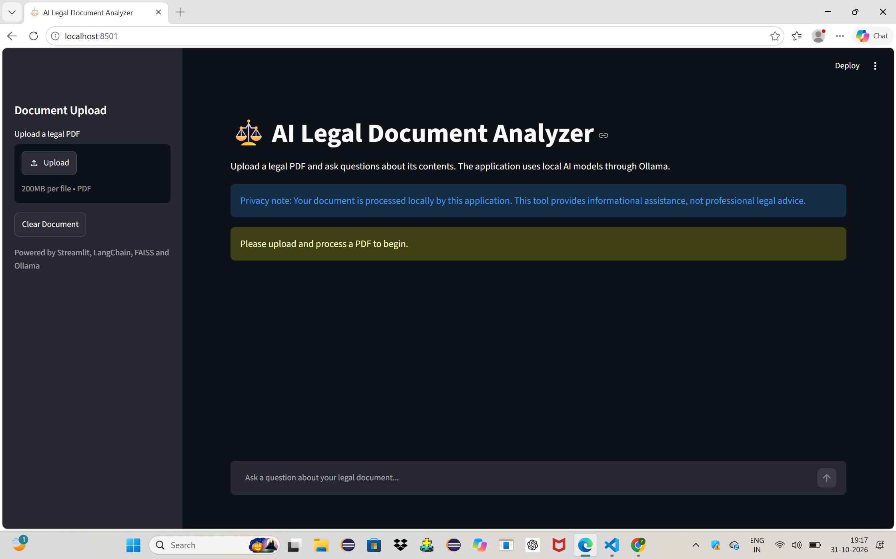
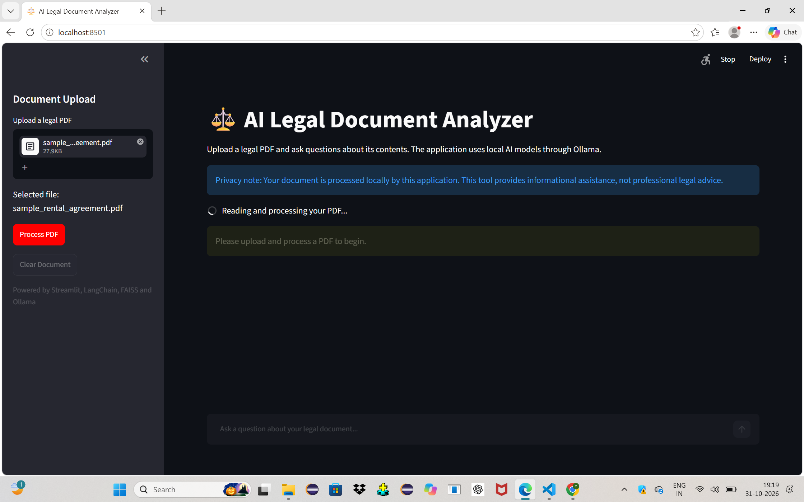
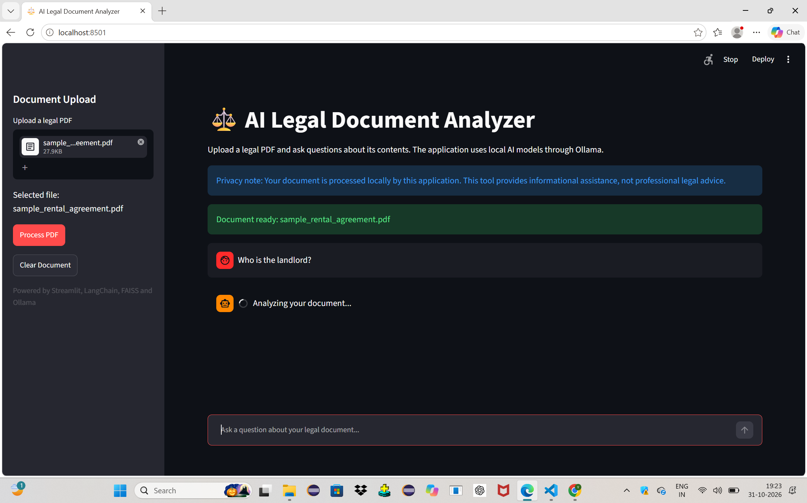
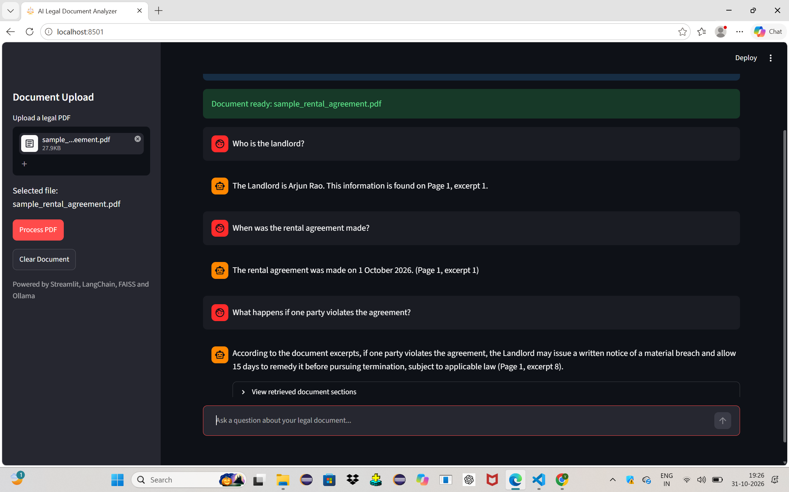

# AI Legal Document Analyzer using RAG

## Overview
AI Legal Document Analyzer is a Retrieval-Augmented Generation (RAG)
based application that helps users understand legal documents.

Users can upload PDF documents and ask questions in natural language.
The system retrieves relevant information from the uploaded document
and generates answers using a locally running Large Language Model.

## Problem Statement
Legal documents often contain lengthy and complex information.
Understanding important clauses, financial details, responsibilities,
and conditions can be difficult and time-consuming.

## Proposed Solution
This project uses RAG to retrieve relevant information from legal PDFs
and generate simple, context-based answers.

## Technologies Used

- Python
- Streamlit
- LangChain
- FAISS
- Ollama
- Llama 3.2
- Nomic Embed Text
- PyPDF

## System Architecture

1. User uploads a legal PDF.
2. PyPDF extracts text from the document.
3. Text is divided into smaller chunks.
4. Nomic Embed Text generates embeddings.
5. FAISS stores and retrieves relevant document chunks.
6. Llama 3.2 generates answers using retrieved context.
7. Streamlit displays answers and source page references.

## Features

- PDF document upload
- Automatic text extraction
- Text chunking
- Semantic search using embeddings
- FAISS vector database
- Question answering using RAG
- Source page references
- Local AI processing without requiring an OpenAI API key

## Installation and Setup

### 1. Clone the repository

```bash
git clone https://github.com/08Harika/AI-Legal-Document-Analyzer-RAG.git
cd AI-Legal-Document-Analyzer-RAG
```

### 2. Create a virtual environment

```bash
py -3.11 -m venv .venv_rag
```

### 3. Activate the environment

Windows Command Prompt

```cmd
.venv_rag\Scripts\activate.bat
```

### 4. Install dependencies

```bash
python -m pip install -r requirements.txt
```

### 5. Install Ollama

Download Ollama from:

https://ollama.com/download/windows

### 6. Download required models

```bash
ollama pull llama3.2
ollama pull nomic-embed-text
```

### 7. Run the application

```bash
.\.venv_rag\Scripts\python.exe -m streamlit run app_local.py
```

## Sample Questions

- What is the monthly rent?
- What is the security deposit?
- Who is responsible for structural repairs?
- What is the termination notice period?
- Summarize the rental agreement.

## Future Enhancements

- Support for multiple document formats.
- OCR support for scanned legal documents.
- Document comparison.
- Improved clause identification.
- Multilingual document analysis.

## Disclaimer

This project is developed for educational and informational purposes.
It does not replace professional legal advice.

## Application Screenshots

### 1. Home Page


### 2. PDF Upload


### 3. Question Analysis


### 4. Question Answering
